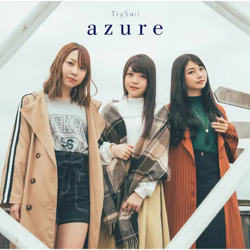

:::{.img-small .border .nonumber}

<figure>
  [{width=512 height=702}
  ](https://static.zerochan.net/Oikura.Sodachi.full.2805028.jpg)

> 向き不向きじゃないの。数学だけは私を裏切らないもの。

  <figcaption>
    ---老倉 育
    ([Oikura "Euler" Sodachi](https://www.zerochan.net/2805028))  
    TVアニメ「終物語」第三巻/そだちロスト
    ([Owarimonogatari/Sodachi Lost](
    https://www.monogatari-series.com/owarimonogatari/package/03.html))  
    キャラクターコメンタリー
    ([character commentary](https://youtu.be/W-RqGvLPpwo?t=1489))
  </figcaption>
</figure>

:::

:::{.img-small .border .nonumber}

<figure>
  [{width=512 height=726}
  ](https://yurucamp.jp/second/images/g_visual_02.jpg)

> さみしいも、たのしい。

  <figcaption>
    ---ティザービジュアル＜夜＞
    ([teaser visual\<night\>](https://yurucamp.jp/second/gallery/))
    キャッチコピー
    ([catch copy](https://yurucamp.jp/news/information/5583))  
    TVアニメ「ゆるキャン△ SEASON２」
    ([Yuru Camp△ SEASON２](https://yurucamp.jp/second/))
  </figcaption>
</figure>

:::

:::{.img-small .border .nonumber}

<figure>
  [{width=512 height=508}
  ](https://gochiusa.com/core_sys/images/contents/00000256/base/001.jpg?1660869136)

> まだ知らないこと　たくさんある　見つけちゃったなら
>
> それは冒険の始まりです　ワクワクするよね！

  <figcaption>
    ---EDテーマ
    チマメ隊／ときめきポポロン♪
    ([Tokimeki Poporon♪](https://www.uta-net.com/song/197310/))  
    TVアニメ「ご注文はうさぎですか？？」
    ([Is the order a rabbit??](https://gochiusa.com/series_cd/2/ed.html))
  </figcaption>
</figure>

:::

:::{.img-small .border .nonumber}

<figure>
  [[{width=512 height=543}]{title="第七十二&#010;地上発電所"}
  ](/assets/blog/quotes/yomenaina.jpg)

> 読めないな…

  <figcaption>
    ---チト ([Chito](http://girls-last-tour.com/character/))  
    少女終末旅行　1巻
    ([_Girls' Last Tour, Vol. 1_](https://www.shinchosha.co.jp/book/771781/))
    つくみず／著
    ([by: Tsukumizu](
    https://yenpress.com/9780316470636/girls-last-tour-vol-1/))
  </figcaption>
</figure>

:::

:::{.img-small .border .nonumber}

<figure>
  [{width=512 height=512}
  ](https://youtu.be/hLnv7XuOqjw)

> 明日　世界が終わるとしたら
>
> 今夜は何を食べよう

  <figcaption>
    ---EDテーマ
    [TrySail 『azure』](https://www.uta-net.com/song/258811/)  
    TVアニメ「続・終物語」
    ([Zoku Owarimonogatari](
    https://www.monogatari-series.com/zokuowarimonogatari/music/))
  </figcaption>
</figure>

:::

:::{.img-large .border .nonumber}

<figure>
  [{width=1024 height=576}
  ](https://misc.cgdct.moe/anime/kousaka.png)

> なれる　もっと練習してもっとうまくなれば　もっと特別になれる
>
> 自分は特別だと思ってるだけのやつじゃない
>
> 本物の特別になる

  <figcaption>
    ---高坂麗奈
    ([Kousaka Reina](http://tv.anime-eupho.com/character/#/reina))  
    TVアニメ「響け！ユーフォニアム」
    ([Hibike! Euphonium](http://tv.anime-eupho.com/))
  </figcaption>
</figure>

:::

:::{.img-large .border .nonumber}

<figure>
  [{width=1024 height=576}
  ](https://misc.cgdct.moe/anime/victims.png)

> 被害者…
> 人数は多いほうが楽しいよ

  <figcaption>
    ---ココア
    ([Cocoa](https://gochiusa.com/chara/cocoa.html))  
    TVアニメ「ご注文はうさぎですか？」
    ([Is the order a rabbit?](https://gochiusa.com/01/))
  </figcaption>
</figure>

:::
